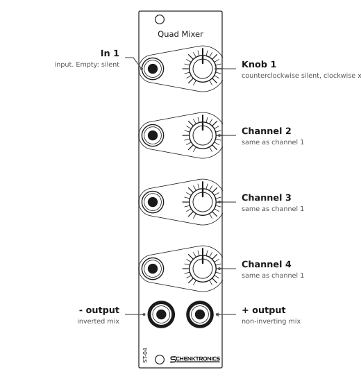

<picture>
  <source media="(prefers-color-scheme: dark)" srcset="docs/images/logo-light.png">
  
</picture>

# 4ch Mixer

A 6HP Eurorack four-channel active mixer from **Schenktronics**. Each channel has an input jack and a level knob that takes the input from silent up to twice its level. The four channels are summed into two outputs: a non-inverting mix (+) and an inverted one (−). Unplugged inputs are silent, so only the channels you patch affect the mix.



## Features

- 6HP Eurorack, 30.48 mm wide, 20 mm deep. Powered from ±12 V.
- Four channels, each with a level knob from silent to ×2
- Two outputs: + (the mix) and − (the mix, inverted)
- Empty inputs are silent, so unused channels add nothing
- Reverse-power protection on both rails

## Documentation

| Document | For | PDF |
|----------|-----|-----|
| [User Manual](docs/manual.md) | Using the module | [PDF](docs/pdf/4ch-mixer-manual.pdf) |
| [Assembly Guide](docs/assembly-guide.md) | Building the kit | [PDF](docs/pdf/4ch-mixer-assembly-guide.pdf) |
| [Bill of Materials](docs/BOM.md) ([CSV](docs/BOM.csv)) | Parts and sourcing | |

## Repository layout

```
hardware/
  mixer/                        Main PCB (KiCad 10)
    4ch Mixer.kicad_sch           Schematic
    4ch Mixer.kicad_pcb           PCB layout
    lib/                          Custom symbols and footprints
  panel/                        Faceplate (KiCad 10, made as an aluminium PCB)
    4ch Mixer Faceplate.kicad_pcb Faceplate layout
manufacturing/
  mixer/                        Gerbers, drill, BOMs and placement files for the main PCB
  panel/                        Gerbers and drill for the faceplate
tools/
  pcb/                          Board generator, placement and annealing scripts
  panel/                        Faceplate generator (holes, ticks, rings, logo, title)
docs/                           Manual, assembly guide, BOM, images
  drawings/                     Scripts that generate the drawings
  pdf/                          PDF versions and their build settings
```

## Fabrication

| Board | Size | Layers | Thickness | Notes |
|-------|------|--------|-----------|-------|
| Main PCB | 30 × 100 mm | 2 | 1.6 mm | Standard green is fine. SMD parts on both sides. |
| Faceplate | 30.48 × 128.5 mm | 1 | 1.6 mm | Aluminium PCB, white solder mask, black silkscreen. Only the front copper layer is used, so FR4 works too. |

The surface-mount BOM and placement file for the board house are in [manufacturing/mixer/](manufacturing/mixer/). Upload the gerbers in each folder to any common PCB fab.

## License

This hardware design and its documentation are licensed under [CC BY-NC-SA 4.0](https://creativecommons.org/licenses/by-nc-sa/4.0/). See [LICENSE](LICENSE).

The Schenktronics name and logo are trademarks of Nathan Schenk and are not covered by the CC BY-NC-SA 4.0 license.

## Links

- Website: <https://schenktronics.com>
