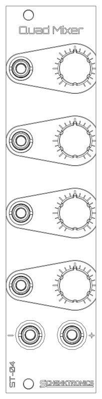

<picture>
  <source media="(prefers-color-scheme: dark)" srcset="docs/images/logo-light.png">
  
</picture>

# ST-04 Quad Mixer

A 6HP Eurorack four-channel active mixer from **Schenktronics**. Each channel has an input jack and a level knob that takes it from silent up to its own level. The four channels are summed into two outputs: a non-inverting mix (+) and an inverted one (-). Unplugged inputs are silent, so only the channels you patch affect the mix.



## Features

- 6HP (30 mm wide), 20 mm deep, powered from ±12 V
- Four channels, each with a level knob from silent to x1
- Two outputs: + (the mix) and - (the mix, inverted)
- Empty inputs are silent, so unused channels add nothing
- Reverse-power protection on both rails
- Kits come with the surface-mount parts already soldered and tested: 48 through-hole joints to build

## Documentation

| Document | For | PDF |
|----------|-----|-----|
| [User Manual](docs/manual.md) | Using the module | [PDF](docs/pdf/ST-04_Quad_Mixer_User_Manual.pdf) |
| [Assembly Guide](docs/assembly-guide.md) | Building the kit | [PDF](docs/pdf/ST-04_Quad_Mixer_Assembly_Guide.pdf) |
| [Bill of Materials](docs/BOM.md) ([CSV](docs/BOM.csv)) | Parts and sourcing | |

## Repository layout

```
hardware/
  ST-04_Quad Mixer.step           3D model of the assembled module
  mixer/                          Main PCB (KiCad 10)
    4ch Mixer.kicad_sch             Schematic
    4ch Mixer.kicad_pcb             PCB layout
    4ch Mixer.step                  3D model
    lib/                            Custom symbols and footprints
  panel/                          Faceplate (KiCad 10, made as an aluminum PCB)
    4ch Mixer Faceplate.kicad_pcb   Faceplate layout
    4ch Mixer Faceplate.step        3D model
docs/                             Manual, assembly guide, BOM, images
  pdf/                              PDF versions of the manual and assembly guide
```

The `.github/` folder holds the automation that builds the PDFs. You can ignore it.

## Fabrication

| Board | Size | Layers | Thickness | Notes |
|-------|------|--------|-----------|-------|
| Main PCB | 30 x 100 mm | 2 | 1.6 mm | Standard green is fine. Surface-mount parts on the back. |
| Faceplate | 30 x 128.5 mm | 1 | 1.6 mm | Aluminum PCB, white solder mask, black silkscreen. Only the front copper layer is used, so FR4 works too. |

## Sourcing your own parts

The [BOM](docs/BOM.md) lists every part, including the surface-mount ones the kits ship with already soldered. The jack pads are oval so the board can also take panel-mount style jacks, which may be easier to source. The CUI MJ-3507 is one example: its sleeve is a solder lug rather than a pin, so each one needs a short wire from that lug to the jack's square pad.

## License

This hardware design and its documentation are licensed under [CC BY-NC-SA 4.0](https://creativecommons.org/licenses/by-nc-sa/4.0/). See [LICENSE](LICENSE).

The Schenktronics name and logo are trademarks of Schenktronics LLC and are not covered by the CC BY-NC-SA 4.0 license.

## Links

- Shop: <https://schenktronics.com/product/st-04/>
- Docs page: <https://schenktronics.com/docs/st-04/>
- Website: <https://schenktronics.com>
