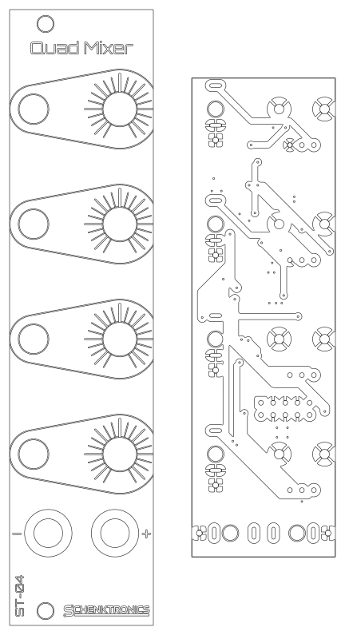
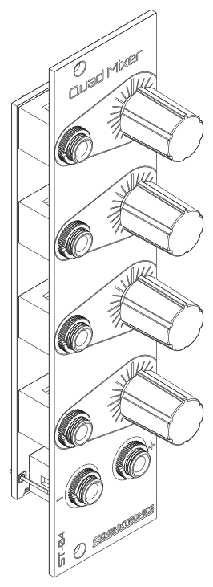

# ST-04 Quad Mixer: Assembly Guide

The board in this kit comes with all the surface-mount parts already soldered by the board house and tested by me, so you only solder the through-hole parts: the power header, the jacks, and the pots. That's 48 solder joints and about 45-60 minutes.

## What you need

### Kit contents

Check your kit against this list before you start (full details in the [BOM](BOM.md)):

- [ ] 1 x main PCB, with the surface-mount parts already soldered
- [ ] 1 x faceplate
- [ ] 1 x 10-pin shrouded power header
- [ ] 6 x 3.5 mm jacks with nuts
- [ ] 4 x potentiometers
- [ ] 4 x knobs
- [ ] 1 x power cable, 10-pin to 16-pin

### Tools

- Soldering iron (about 330-360 °C for leaded solder)
- Solder
- Multimeter with continuity (beep), diode test, resistance, and DC voltage modes
- Small pliers (optional, for squaring up the jacks)
- Nut driver or wrench for the jack nuts (optional, but less likely to scratch the panel than pliers)

## Before you start

- The board has two sides. The **back** has the surface-mount parts, and it's printed "ST-04 v1.0 / Quad Mixer", "schenktronics.com", "CC BY-NC-SA 4.0", and "-12V", "+12V", and "Red Stripe" by the power header. The **front** has the outlines for the pots and jacks (RV1-RV4, J1-J6).
- Build in this order: the power header first, then the pots and jacks. The header is easier to reach before anything else is in the way.
- **Don't solder the pots or jacks until the faceplate is on.** The faceplate holds them in line while you solder.

### First time soldering?

You only need the basics for this kit:

- Touch the iron to the pad and the pin at the same time, then feed solder into the joint, not onto the iron tip. A second or two is usually enough.
- A good joint is shiny and shaped like a small cone around the pin. A dull, lumpy blob usually means the pad didn't get hot enough. Reheat it, use some flux, and add a touch more solder if necessary.
- Keep the tip clean and lightly tinned. Wipe it on a damp sponge or brass wool between joints.
- Remember that solder flows toward the heat.

## Step 1: Fit the power header

1. Push the header into its holes from the **back**. Turn it so the notch in the shroud is on the same side as the "-12V" marking. Pin 1 (the square pad) is -12 V, next to that marking. Pins 1 and 2 are -12 V, pins 9 and 10 are +12 V, and pins 3 to 8 are ground.
2. Turn the board over and solder one pin on the front. Check that the header sits flat against the board. If it doesn't, reheat the pin and press it down.
3. Solder the other nine pins.

## Step 2: Check for shorts

Before you add anything else, check the power rails with a multimeter in diode test mode (the diode symbol). No power is needed. Probe the header pins from the front of the board.

Use diode test mode, not resistance mode. Most meters test resistance at too low a voltage to turn a diode on, so a protection diode fitted backwards reads as an open circuit in resistance mode and looks fine. Diode test mode uses a higher voltage and shows the diode's forward voltage instead.

| Test | Expected result |
|------|-----------------|
| Red probe on pin 9 (+12 V), black on pin 3 (ground) | OL, or a high reading. It may count up for a moment while the capacitors charge. |
| Red probe on pin 3 (ground), black on pin 1 (-12 V) | OL, or a high reading. It may count up for a moment. |
| Red probe on pin 3 (ground), black on pin 9 (+12 V) | About 0.5-0.7 V: D1 conducting |
| Red probe on pin 1 (-12 V), black on pin 3 (ground) | About 0.5-0.7 V: D2 conducting |
| Red probe on pin 9 (+12 V), black on pin 1 (-12 V) | OL |

A reading near 0 V (many meters also beep) means a short. The surface-mount side was tested before it shipped, so look for a solder bridge between the header pins you just soldered. If the header looks clean and a reading is still wrong, [get in touch](https://schenktronics.com/contact/) before you power it up.

## Step 3: Fit the pots and jacks

1. Push the four pots into RV1-RV4 from the **front** of the PCB. Each pot only fits one way round: the three pins go in the row of three small holes, and the two mounting lugs go in the large holes. The lugs clip into the board and hold the pot in place.
2. Push the six jacks in from the front. J1 to J4 are the inputs, one per channel, from the top. J5 (the **+** output) and J6 (the **-** output) are at the bottom: J6 on the left and J5 on the right, matching the "-" and "+" on the faceplate. Make sure each jack sits flat with all three legs through their holes.
3. Don't solder anything yet.

## Step 4: Fit the faceplate

1. Take the nuts off the jacks and set them aside. The pots have no nuts.
2. Lower the faceplate over the parts. The "Quad Mixer" title goes at the top, over J1 and RV1, and the **+** and **-** outputs go at the bottom. The pot shafts go through the four bigger holes.
3. Rubber bands or small spring clips can be helpful to hold the faceplate and the board together while you work.
4. Put the jack nuts back on, finger-tight for now.
5. Check that each pot shaft is centered in its hole, and that the PCB is parallel to the faceplate. The shafts are thinner than their holes, and only the solder will hold them, so centering them now stops the knobs rubbing later. The legs have a little play in their holes, which gives you room to adjust.
6. Snug the nuts down. Don't overtighten: it can strip the jack threads or mark the panel.

## Step 5: Solder the pots and jacks

Turn the whole thing over and solder from the back of the PCB, between the surface-mount parts.

1. Tack one pad of each part: the square pad of each jack, and the middle pin of each pot. Then check again that the pot shafts are still centered. If one isn't, reheat that joint and adjust.
2. Use a small pair of pliers to rotate the jacks as necessary to align them squarely with each other. This step is optional, but a nice touch.
3. Solder the remaining pins and pads: the tip (T) and switch (TN) pins of each jack, and pins 1 and 3 of each pot.
4. Solder the eight mounting-lug pads of the pots. They connect to ground, so they take a little longer to heat. Hold the iron on until the solder flows into the hole.

> **Sourcing your own jacks?** The footprint also takes CUI MJ-3507 jacks (the ones in the Mouser parts list). Their tip and switch pins go into the board, but the sleeve is a solder lug on the jack, not a pin. Tack the tip pin instead of the square pad, then solder a short wire from each jack's sleeve lug to its square pad. Without the wire, the jack has no ground.

Look over every joint before moving on. Each should be shiny and cone-shaped, with no solder bridging neighboring pads.

## Step 6: Fit the knobs

Push each knob onto its pot shaft. The flat on the shaft sets the knob's position. Each pointer should point straight up, at the center mark on the panel, when the pot is at its center. Check that each knob turns without rubbing on the panel.

## Step 7: Test

### Without power

Repeat the rail test from Step 2 on the header pins. Then check the jacks and pots from the back of the board:

| Test | Expected result |
|------|-----------------|
| Each input jack (J1-J4), with no plug in: tip pin (T) to sleeve pin (S) | Beep. The switch contact connects the tip to ground when the jack is empty. |
| Each output jack (J5, J6): tip (T) to sleeve (S), in resistance mode | About 11 kΩ, not a beep. The output resistors and their load resistors are in the way. |
| Each pot: wiper (pin 2) to pin 3, in resistance mode, turning the knob | Changes from about 0 to about 100 kΩ as you turn it |

Then plug a patch cable into each input. The beep should stop, because the plug breaks the connection to ground. If it doesn't, check the jack's switch pin (TN).

### With power

Connect the module to your case (see [Install](#step-8-install)), with the red stripe on -12 V at both ends, and power on. If anything gets hot or smells, power off at once and check the power cable.

**Empty inputs:** with nothing plugged into any input, measure both outputs with the multimeter on DC volts, at the tip and sleeve of each output jack. Turn the knobs through their range. Each output should read about 0 V the whole time, because each empty input is connected to ground.

**Gain:** plug a steady DC voltage of about 2 V into In 1 (an offset from another module, or a bench supply). Measure the outputs with Knob 1 at each setting:

| Knob 1 | + output (J5) | - output (J6) |
|--------|---------------|---------------|
| Fully counterclockwise | About 0 V | About 0 V |
| Center | About +1 V | About -1 V |
| Fully clockwise | About +2 V | About -2 V |

Then repeat the test for In 2, In 3, and In 4.

## Step 8: Install

Mount the module in your case with the included power cable and two M3 rack screws. The details, and how to use the module, are in the [User Manual](manual.md#installation).

## Troubleshooting

| Symptom | Likely cause |
|---------|--------------|
| Nothing works, and the power supply struggles or a fuse trips | The power cable is plugged in backwards, or there's a solder bridge on the power header. |
| Both outputs are dead, and nothing gets hot | The power header isn't soldered well. Reflow its ten pins. |
| An empty input isn't silent | The jack's switch pin (TN) isn't soldered well. The empty input should beep to ground in the Step 7 test. |
| One channel is dead | A bad joint on that jack's tip (T), or on the pot's pins. Reflow them. |
| A knob works backwards | The pot is a different type from the one in the BOM. |
| A knob rubs on the panel | The shaft isn't centered in its hole, or the knob is pushed on too far. |
| Something else, or a fault on the surface-mount side | [Get in touch](https://schenktronics.com/contact/). The surface-mount parts were tested before your kit shipped. |
