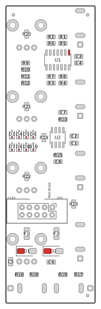
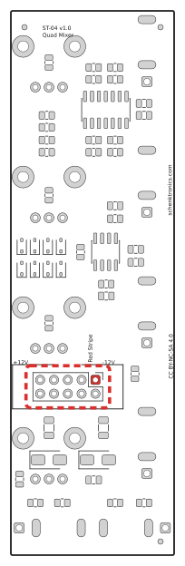
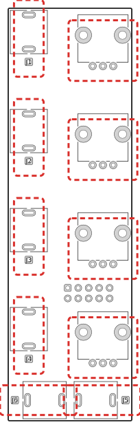
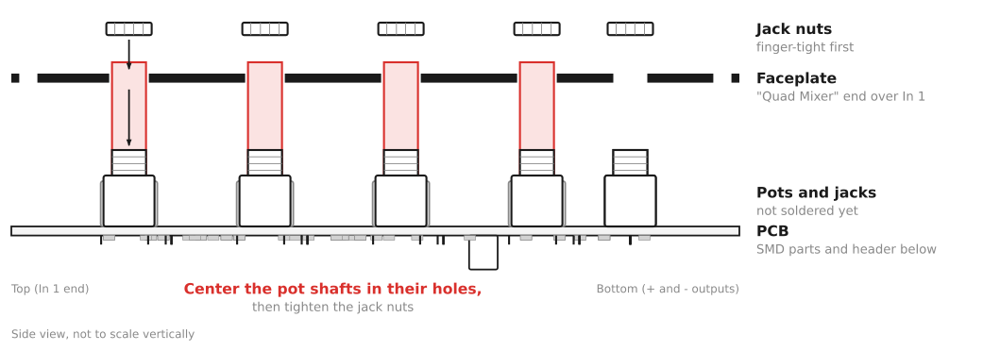
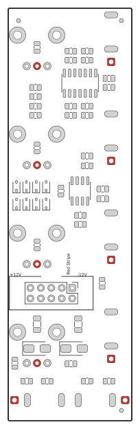

# 4ch Mixer — Assembly Guide

This kit has 156 solder joints, 108 of them on surface-mount parts: 0805 resistors and capacitors, diodes, fuses and two chips. It takes about 2–3 hours if you're experienced with surface-mount soldering, and longer if you're not. If you haven't soldered surface-mount parts before, practice on a scrap board first, or start with a through-hole kit.

**Building the Easy Build Kit?** Its board arrives with every surface-mount part already soldered and tested, so skip [Step 1](#step-1--solder-the-surface-mount-parts) and start at [Step 2](#step-2--fit-the-power-header). That leaves 48 through-hole joints, about 45–60 minutes, and no surface-mount soldering at all.

## What you need

### Kit contents

Check your kit against this list before you start (full details in the [BOM](BOM.md)).

**Easy Build Kit:** your board already has these soldered on. Check they're present and well soldered, and don't source loose parts for them:

- [ ] 1 × TL074 quad op-amp (U1, 14 pins)
- [ ] 1 × TL072 dual op-amp (U2, 8 pins)
- [ ] 17 × 10 kΩ resistors (R1–R17)
- [ ] 6 × 1 kΩ resistors (R18–R23)
- [ ] 4 × 0.1 µF capacitors (C1–C4)
- [ ] 2 × 10 µF capacitors (C5, C6)
- [ ] 2 × 10 pF capacitors (C7, C8)
- [ ] 2 × MRA4003 diodes (D1, D2)
- [ ] 8 × 1N4148 diodes (D3–D10)
- [ ] 2 × resettable fuses (F1, F2)

**Every kit**, loose:

- [ ] 1 × main PCB (Easy Build Kit: surface-mount parts above already soldered on)
- [ ] 1 × faceplate
- [ ] 1 × 10-pin shrouded power header
- [ ] 6 × 3.5 mm jacks with nuts
- [ ] 4 × potentiometers
- [ ] 4 × knobs
- [ ] 1 × power cable, 10-pin to 16-pin

If you're soldering the surface-mount parts yourself, the capacitors have no markings, so the three values look alike, and resistor markings vary between makers. Keep each value in its labelled strip or bag until you place it.

### Tools

- Soldering iron with a fine tip (about 330–360 °C for leaded solder)
- Thin solder, 0.5 mm or less
- Fine tweezers (Step 1 only — skip if you have the Easy Build Kit)
- Flux (a pen or syringe) and solder wick, for fixing bridges (Step 1 only — skip if you have the Easy Build Kit)
- A magnifier or loupe, to inspect the surface-mount joints
- Flush cutters
- Multimeter with continuity (beep), diode test and DC voltage modes
- Nut driver or wrench for the jack nuts (optional, but it avoids scratching the panel)

## Before you start

- The board has two sides. The **back** has the small rectangular pads for the surface-mount parts, and is printed "−12V", "+12V" and "Red Stripe" near the power header. The **front** has the outlines for the pots and jacks (RV1–RV4, J1–J6), and is printed "Quad Mixer V1.0".
- Build in this order: surface-mount parts, then the power header, then the pots and jacks. Each stage is easier while the next one isn't in the way. (Easy Build Kit: the surface-mount stage is already done — start at the power header.)
- **Don't solder the pots or jacks until the faceplate is fitted.** The faceplate holds them in line while you solder.
- **Check every diode's stripe against the drawings before you solder it.** A reversed diode is the most likely fault, and the checks in Step 3 catch it before the module is powered.

## Step 1 — Solder the surface-mount parts

**Easy Build Kit: skip this step.** Your board already has these parts soldered and tested at the factory. Go to [Step 2](#step-2--fit-the-power-header).

All of these go on the back of the board. For every two-pad part, use the same method:

1. Put a little solder on one pad.
2. Hold the part with tweezers, slide it onto the pads, and reheat the tinned pad so the part settles flat.
3. Solder the other pad, then go back and touch up the first one.

Work in this order, from the most difficult part to the easiest:

1. **U1 (TL074).** Line up the dot or notch on the chip with the pin 1 pad, marked red in the drawing. Tack one corner pin, check that all 14 pins sit on their pads, then tack the opposite corner. Solder the rest. If two pins bridge, add flux and clean the bridge with wick.
2. **U2 (TL072).** Same method, with 8 pins. Pin 1 is marked on the board.
3. **Resistors**, one value at a time:

   | Value | Where |
   |-------|-------|
   | 10 kΩ (17) | R1–R17 |
   | 1 kΩ (6) | R18–R23 |

4. **Capacitors**, one value at a time. Open one strip at a time so you don't mix them up.

   | Value | Where |
   |-------|-------|
   | 0.1 µF (4) | C1–C4 |
   | 10 µF (2) | C5, C6 |
   | 10 pF (2) | C7, C8 |

5. **D1 and D2 (MRA4003).** The stripe (cathode) end goes on the red pad in the drawing. D1's stripe goes to the **+12 V** side, and D2's stripe goes to the **ground** side. These diodes protect the module if the power cable goes in backwards, so a reversed diode shorts the power rail.
6. **D3–D10, the eight 1N4148 input clamp diodes.** Each one sits between an op-amp input and a rail. The stripe end goes on the red pad, and the table says which side each stripe faces. A reversed clamp can pull its channel to about ±10 V, so check each one against the table before you solder it.

   | Diode | Stripe end goes to | Other end goes to |
   |-------|--------------------|-------------------|
   | D3 | +12 V | the pad shared with R20 (the channel 1 input) |
   | D4 | the pad shared with R20 | −12 V |
   | D5 | +12 V | the pad shared with R21 (channel 2) |
   | D6 | the pad shared with R21 | −12 V |
   | D7 | +12 V | the pad shared with R22 (channel 3) |
   | D8 | the pad shared with R22 | −12 V |
   | D9 | +12 V | the pad shared with R23 (channel 4) |
   | D10 | the pad shared with R23 | −12 V |

7. **F1 and F2**, the resettable fuses. They work either way round.

Check every joint with a magnifier. Each one should be a smooth fillet from the pad up the end of the part, with no bridges between U1's pins.

## Step 2 — Fit the power header

1. Push the header into its holes from the **back**. Turn it so the notch in the shroud is on the same side as the "−12V" marking. Pin 1 (the square pad) is −12 V, next to that marking. Pins 1 and 2 are −12 V, pins 9 and 10 are +12 V, and pins 3 to 8 are ground.
2. Turn the board over and solder one pin on the front. Check that the header sits flat against the board; if not, reheat the pin and press it down.
3. Solder the other nine pins.

## Step 3 — Check for shorts

Before adding the rest, check the power rails with a multimeter in diode test mode (the diode symbol). No power is needed. Probe the header pins from the front of the board. Worth doing on the Easy Build Kit too: the factory tested the surface-mount side, but you've just soldered the header yourself.

Use diode test mode, not resistance mode. Most meters test resistance at too low a voltage to turn a diode on, so a diode fitted backwards reads as an open circuit in resistance mode and looks fine. Diode test mode uses a higher voltage and shows a diode's forward voltage instead.

**Power rails** (header pins):

| Test | Expected result |
|------|-----------------|
| Red probe on pin 9 (+12 V), black on pin 3 (ground) | OL, or a high reading. It may count up for a moment while the capacitors charge. |
| Red probe on pin 3 (ground), black on pin 1 (−12 V) | OL, or a high reading. It may count up for a moment. |
| Red probe on pin 3 (ground), black on pin 9 (+12 V) | About 0.5–0.7 V: D1 conducting. |
| Red probe on pin 1 (−12 V), black on pin 3 (ground) | About 0.5–0.7 V: D2 conducting. |
| Red probe on pin 9 (+12 V), black on pin 1 (−12 V) | OL. A reading of about 1–1.5 V means two clamp diodes on one channel are both reversed and shorting the rails. |

What a wrong reading means:

- **Near 0 V** (many meters also beep) in any test: a short. Look for a solder bridge on U1 or U2, or on the power header.
- **OL in the third or fourth test:** D1 or D2 is missing, fitted backwards, or not soldered. A diode fitted backwards would short the rail as soon as you power on, so fix it now.
- **About 1–1.5 V in the fifth test:** both clamp diodes of one channel are fitted backwards. Check the pair in the next table.

**Input clamp diodes** (on the back of the board, before the pots and jacks go in). Use the pads at each end of the diode, not the header. Red probe on the anode end (the end without the stripe), black probe on the stripe end:

| Diode | Red probe on | Black probe on | Expected |
|-------|--------------|----------------|----------|
| D3 | the pad shared with R20 | +12 V pad | About 0.5–0.7 V |
| D4 | −12 V pad | the pad shared with R20 | About 0.5–0.7 V |
| D5 | the pad shared with R21 | +12 V pad | About 0.5–0.7 V |
| D6 | −12 V pad | the pad shared with R21 | About 0.5–0.7 V |
| D7 | the pad shared with R22 | +12 V pad | About 0.5–0.7 V |
| D8 | −12 V pad | the pad shared with R22 | About 0.5–0.7 V |
| D9 | the pad shared with R23 | +12 V pad | About 0.5–0.7 V |
| D10 | −12 V pad | the pad shared with R23 | About 0.5–0.7 V |

If a diode in this table reads OL, it's fitted backwards, missing, or not soldered. If it reads about 0 V, look for a bridge.

## Step 4 — Fit the pots and jacks

1. Push the four pots into RV1–RV4 from the **front** of the PCB. Each pot fits only one way round: the three pins go in the row of three small holes, and the two mounting lugs go in the large holes. The lugs clip into the board and hold the pot in place.
2. Insert the six jacks from the front. J1 to J4 are the inputs, one per channel, from the top. J5 (the **+** output) and J6 (the **−** output) are at the bottom: J6 on the left and J5 on the right, matching the printed "−" and "+" on the faceplate. Make sure each jack sits flat, with all its legs through their pads.
3. Don't solder anything yet.

## Step 5 — Fit the faceplate

1. Remove the nuts from the jacks. The pots have no nuts.
2. Lower the faceplate over the parts. The "Quad Mixer" title goes at the top, over J1 and RV1, and the **+** and **−** outputs go at the bottom. The pot shafts go through the four larger holes.
3. Put the jack nuts back on and tighten them **finger-tight** for now.
4. Check that each pot shaft is centered in its hole, and that the PCB is parallel to the faceplate. The shafts are thinner than their holes, and nothing but the solder will hold them, so centering them now stops the knobs rubbing later. The legs have a little play in their holes, which gives you room to adjust.
5. Tighten the jack nuts snugly. Do not overtighten them, because that can crack the jack threads or mark the panel.

## Step 6 — Solder the pots and jacks

Turn the assembly over and solder from the back of the PCB, between the surface-mount parts.

1. Tack one pad of each part: the square pad of each jack, and the middle pin of each pot. Then check again that the pot shafts are still centered. If one isn't, reheat that joint and adjust.
2. Solder the remaining pins and pads: the tip (T) and switch (TN) pins of each jack, and pins 1 and 3 of each pot.
3. Solder the eight mounting-lug pads of the pots. They connect to ground, so they take a little longer to heat. Hold the iron on until the solder flows into the hole.
4. Trim any long leads with flush cutters.

> **Building with CUI MJ-3507 jacks** (the ones in the Mouser parts list)? Their tip and switch pins go into the board, but the sleeve is a solder lug on the jack, not a pin. Tack the tip pin instead of the square pad, then solder a short wire from each jack's sleeve lug to its square pad. Without the wire, the jack has no ground.

## Step 7 — Fit the knobs

Push each knob onto its pot shaft. The flat on the shaft sets the knob's position. Turn each knob to its center click and check that the pointer points straight up, at the center mark on the panel. Check that each knob turns without rubbing on the panel.

## Step 8 — Test

### Without power

Repeat the rail test from Step 3 on the header pins. Then check the jacks and outputs from the back of the board:

| Test | Expected result |
|------|-----------------|
| Each input jack (J1–J4), with no plug in: tip pin (T) to sleeve pin (S) | Beeps. The switch contact connects the tip to ground when the jack is empty. |
| Each output jack (J5, J6): tip (T) to sleeve (S) | About 11 kΩ, not a beep. The output resistors and their load resistors are in the way. |
| Each pot: wiper (pin 2) to pin 3, turning the knob | Changes from about 0 to about 10 kΩ as you turn it. |

Then plug a patch cable into each input. The beep should stop, because the plug breaks the connection to ground. If it doesn't, check the jack's switch pin (TN).

### With power

Connect the module to your case (see [Install](#step-9--install)), with the red stripe on −12 V at both ends, and power on. If anything gets hot or smells, power off at once and check the diodes and U1 and U2.

**Empty inputs:** with nothing plugged into any input, measure both outputs with the multimeter on DC volts, at the tip and sleeve of each output jack. Turn the knobs through their range. Each output should read about 0 V the whole time, because each empty input is connected to ground.

**Gain:** plug a steady DC voltage of about 2 V into In 1 (a DC offset from another module, or a bench supply). Measure the outputs with Knob 1 at each setting:

| Knob 1 | + output (J5) | − output (J6) |
|--------|---------------|---------------|
| Fully anticlockwise | About 0 V | About 0 V |
| Center click | About +2 V | About −2 V |
| Fully clockwise | About +4 V | About −4 V |

Then repeat the test for In 2, In 3 and In 4. If the center reads far from 2 V, or the outputs don't match each other, see the troubleshooting table.

## Step 9 — Install

Install the module in your case with the included power cable and four M3 rack screws (two will do). The details, and how to use the module, are in the [User Manual](manual.md#installation).

## Troubleshooting

| Symptom | Likely cause |
|---------|--------------|
| Nothing works, and the power supply struggles, a fuse trips or U1 gets hot | A short on a power rail: a solder bridge on U1 or U2, U1 or U2 fitted the wrong way round (check pin 1), a diode fitted backwards (D1 to D10), or the power cable plugged in backwards. A rail test of about 1–1.5 V points to a reversed clamp pair on one channel. |
| An empty input isn't silent | The jack's switch contact (TN) isn't soldered, or the jack has no switch. The empty input should beep to ground in the Step 8 test. |
| One channel is dead | A bad joint on that jack's tip (T), or on the pot's pins, or the channel's 1 kΩ input resistor (R20–R23). |
| Both outputs are dead, but every channel is fine | A bad joint or missing part in the summing stage: U2, or R9–R15. Check U2's power pins (4 and 8). |
| One output is dead | The 1 kΩ output resistor for that output is missing (R18 for +, R19 for −), or its joint is bad. |
| An output is stuck near +10 V or −10 V | The channel's feedback resistor is missing (R5–R8 for U1, one per channel), or its clamp diode is reversed. |
| The center reads far from about 2 V, or the outputs don't match | A resistor of the wrong value beside that channel (check R1–R12, and R13–R15 for the summing stage), or a pot of a different type from the BOM. |
| A knob works backwards | The pot is a different type from the one in the BOM. |
| A knob rubs on the panel | The shaft isn't centered in its hole, or the knob is pushed on too far. |
