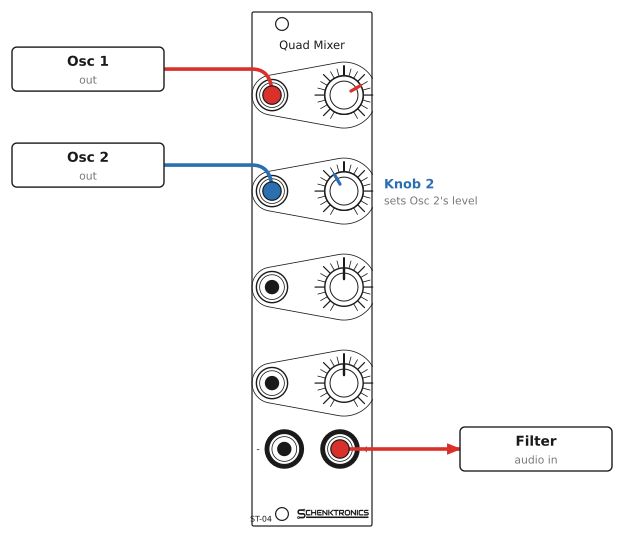
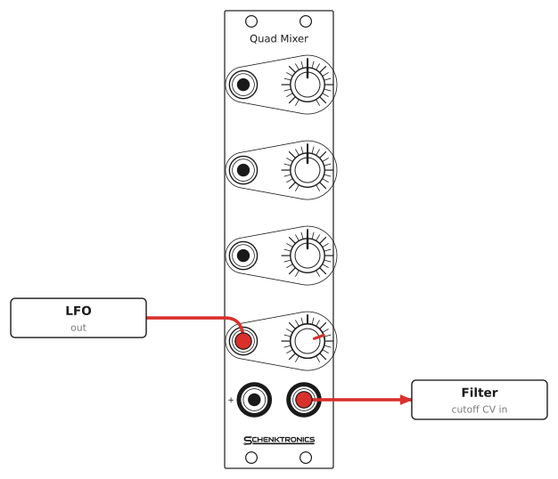
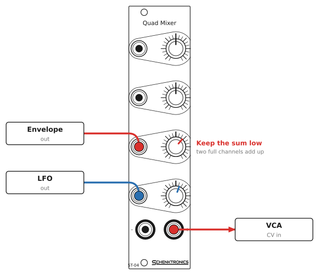

# 4ch Mixer — User Manual

## Overview

The 4ch Mixer is a 6HP Eurorack mixer with four channels. Each channel has an input jack and a knob. The knob sets how much of its input goes into the mix, and each channel can be turned up to twice its input level. The four channels are summed into two outputs: **+**, the mix as it came in, and **−**, the same mix upside down.

The mixer is active: it needs ±12 V from your case's power supply.

An input with nothing plugged into it is silent. Only the channels you patch affect the mix.

## Specifications

| | |
|---|---|
| Format | Eurorack, 6HP |
| Panel | 30.48 × 128.5 mm |
| Depth | 20 mm |
| Power | ⟨check⟩ mA on +12 V, ⟨check⟩ mA on −12 V, no +5 V. 10-pin header. |
| Protection | Reverse-power diodes and resettable fuses on both rails, and clamp diodes on each op-amp input |
| Jacks | 6 × 3.5 mm mono (TS): 4 inputs, 2 outputs |
| Controls | 4 × knobs, 10 kΩ linear potentiometers with a center detent, 6 mm D shaft |
| Channel gain | 0 fully anticlockwise, ×1 at the center detent, ×2 fully clockwise |
| Input impedance | About 10 kΩ. A source with a high output impedance loses a little level into it. |
| Empty inputs | Silent |
| Outputs | + (non-inverting mix) and − (inverted mix) |
| Output impedance | 1 kΩ |
| Output swing | About ±10 V, limited by the op-amps running on ±12 V |
| Signals | Audio, CV and gates. DC-coupled. |

## Panel layout

The panel has four identical channels, numbered 1 to 4 from the top. Each channel has its input jack on the left and its knob on the right. The two outputs are at the bottom: **−** on the left and **+** on the right. The printed "+" and "−" mark the outputs' polarity.

## Using the mixer

### Knobs

Each knob sets the level its channel adds to the mix:

| Knob position | Channel level |
|---------------|---------------|
| Fully anticlockwise | Silent: 0 |
| Center (the click) | About ×1: the input passes at its own level |
| Fully clockwise | About ×2: twice the input |

The center click is easy to find by feel, so it's quick to return a channel to unity gain.

Turn a knob's channel up to add that input to the mix. Turn it to one end to leave the input out without unplugging it.

### Empty inputs are silent

An input with nothing plugged in is connected to ground, so it adds nothing to the mix, whatever its knob is set to. You can leave unused channels patched or unpatched, and nothing changes in the mix until you plug something in.

### The + and − outputs

Both outputs carry the same mix. The **+** output has the same polarity as the inputs. The **−** output is upside down: a rising signal falls, and a +3 V CV becomes −3 V. Use the − output when you want an inverted copy of a mix, or when the module you're patching to needs the opposite direction. The outputs are independent, so you can use either or both.

### Mixing levels

The mix is a sum, so loud signals add up. Each channel is up to ×2, and the outputs clip above about ±10 V. In practice:

- A single channel at full level clips at an input of about ±5 V. Keep the knob below full for hotter signals.
- Several channels together clip sooner. The outputs clip when the inputs, added together, reach about ±5 V with the knobs at full. Four channels at ±1.25 V each, all at full, get there.

If the output sounds distorted or a CV stops tracking, turn the loudest channel down.

## Patch examples

Each drawing shows the modules that send signals on the left and the modules that receive them on the right.

### Blend two oscillators

Plug each oscillator into its own channel, and turn the knobs to balance them. Send the + output to the filter, so the filter hears both oscillators together.

### Use the inverted output

Patch an LFO into In 4 and send the **−** output to the filter's cutoff CV. The LFO's rise now closes the filter instead of opening it. Set Knob 4 for the depth.

### Sum two CVs

Patch an envelope and an LFO into two channels, and send the **+** output to a VCA's CV input. Both modulate the VCA at once. Keep the knobs below full, since two channels at full can clip the sum.

## Good practice

- **Don't patch outputs together.** Joining an output to another module's output makes the two fight each other. Use another channel of the mixer to combine them.
- **Watch the ×2 gain on pitch CV.** At full level a channel doubles its input, so a 1 V/octave pitch CV becomes 2 V/octave. Keep pitch CV below full, or send it through the mixer only if you want the change.
- **Clipping is a level problem.** If the mix sounds harsh or a CV stops at about ±10 V, lower the knobs or the source levels, rather than adding more channels.
- **Check an unexpected silence.** An empty input is silent, so if a channel you expected to hear is quiet, check that its jack is plugged in and its knob isn't at the end.
- **Use a switched jack.** Any input you want to be silent when empty needs its jack's switch contact. The jacks in the kit have one.

## Installation

1. Power off your case.
2. Connect a 10-pin to 16-pin Eurorack power cable to the header on the back of the module. The red stripe goes to **−12 V**, marked "Red Stripe" and "−12V" on the board. At the bus board end, the red stripe also goes to −12 V, usually marked on the bus.
3. Place the module in any 6HP space.
4. Secure it with four M3 rack screws, one in each corner hole. Two screws, in diagonally opposite corners, will hold it if your case is short of screws, but four look neater. Do not overtighten them.
5. Power on. With nothing plugged in, both outputs should read 0 V, whatever the knobs are set to.

The module is protected against a cable plugged in backwards, but don't rely on it. Always check the red stripe before powering on.

## Circuit

The inputs are switched jacks, so an empty jack connects its input to ground. A plugged-in signal goes to one end of a 10 kΩ potentiometer, whose other end is grounded. The wiper goes through a 1 kΩ resistor to the non-inverting input of one channel of a TL074 quad op-amp (U1), wired as an amplifier with a gain of 2. Each op-amp input has two clamp diodes, which hold it between about +12 V and −12 V.

The four channels feed a summing amplifier (U2, a TL072), through 10 kΩ resistors. U2's first half inverts the sum, which is the **−** output, through 1 kΩ. Its second half inverts that again, giving the **+** output, through 1 kΩ. A 10 pF capacitor across each of U2's feedback resistors keeps the summing stages stable. Each rail has two 0.1 µF capacitors and a 10 µF capacitor to ground.

The power input has a resettable fuse and a reverse-biased diode on each rail. If the power cable is plugged in backwards, the diodes conduct and the fuses trip, protecting the circuit. The schematic is in [hardware/mixer/4ch Mixer.kicad_sch](../hardware/mixer/4ch%20Mixer.kicad_sch) (KiCad 10).
